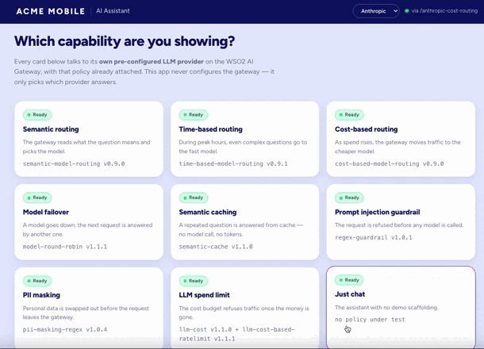
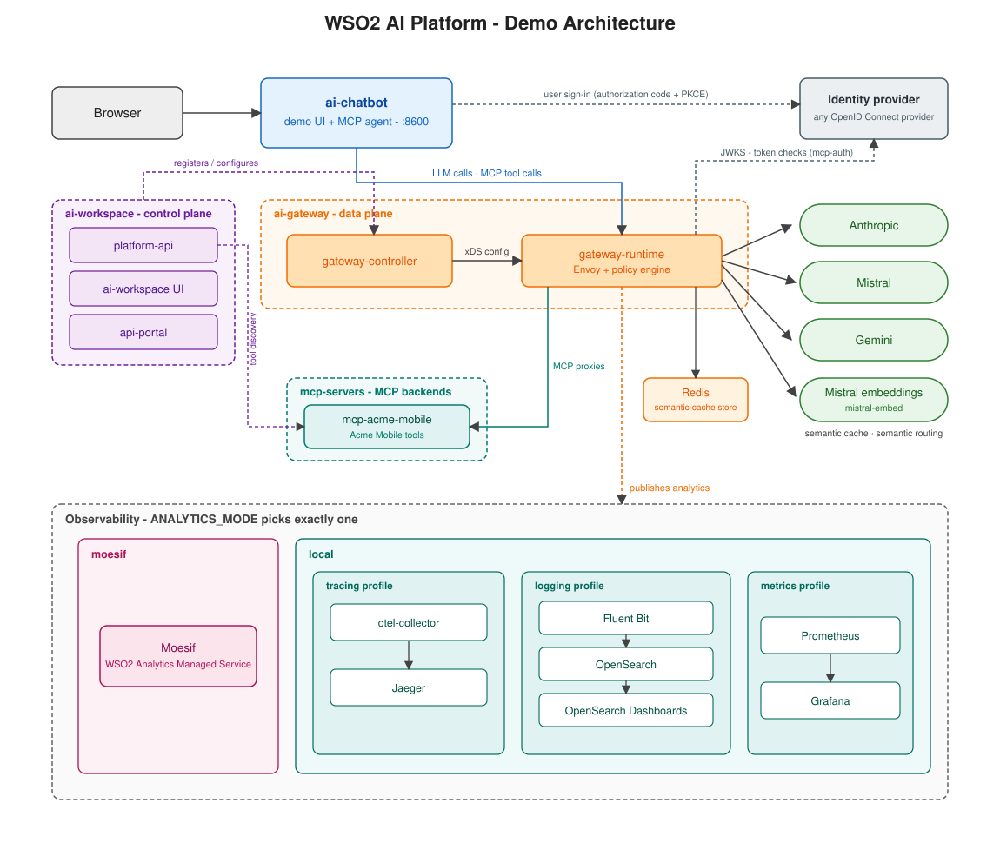
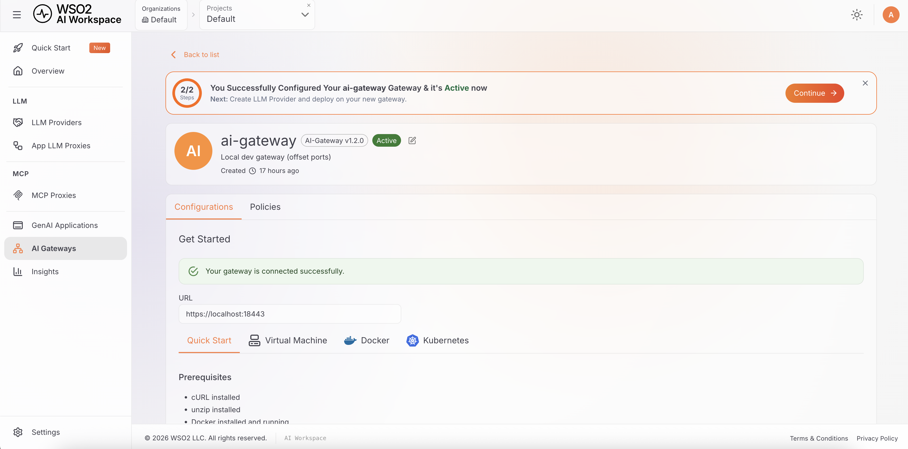
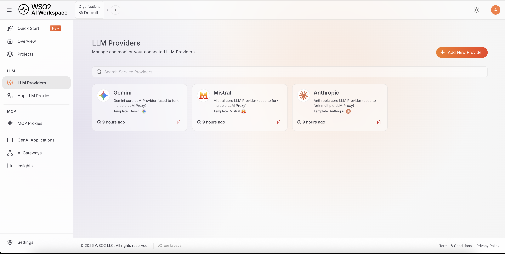
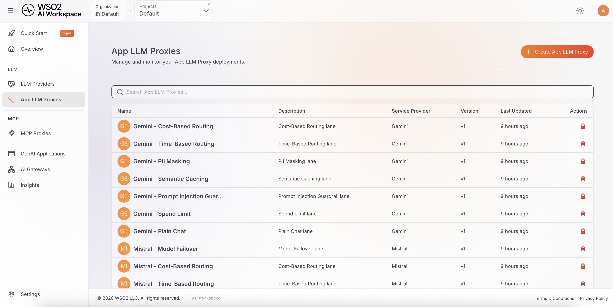
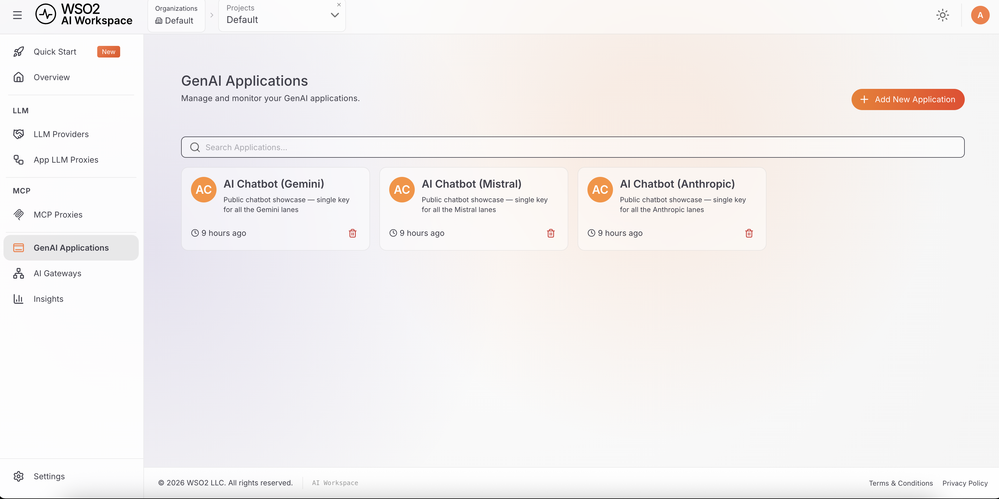

# WSO2 AI Platform — Demo

A self-contained, local demo of the WSO2 AI Platform's LLM gateway: nine
showcases, each driving a real policy (routing, caching, guardrails, spend
limits, failover...) against Anthropic, Mistral and Gemini. Everything runs
on your machine with Docker Compose — nothing to deploy, nothing shared.

## Overview

Three components, wired together:

- **ai-chatbot** — the demo UI. A small chat app with one card per showcase.
- **ai-gateway** — the WSO2 AI Gateway. Every request is policy-enforced
  before it reaches an LLM provider.
- **ai-workspace** — the control plane. Registers the gateway and configures
  its providers and policies.

| Showcase | What it shows |
|---|---|
| Just chat | The assistant with no demo scaffolding |
| Semantic routing | The gateway reads what the question means and picks the model |
| Time-based routing | During peak hours, even complex questions go to the fast model |
| Cost-based routing | As spend rises, the gateway moves traffic to the cheaper model |
| Model failover | A model goes down; the next request is answered by another one |
| Semantic caching | A repeated question is answered from cache — no model call, no tokens |
| Prompt injection guardrail | The request is refused before any model is called |
| PII masking | Personal data is swapped out before the request leaves the gateway |
| LLM spend limit | The cost budget refuses traffic once the money is gone |

## Preview



## Architecture



Every showcase is its own lane: one gateway proxy per (showcase, provider),
each with the policy it demonstrates already attached. `ai-chatbot` never
configures the gateway at request time — it only picks which lane to call.

## Project structure

```
wso2-api-platform-ai-demo/
├── ai-chatbot/       demo UI + the nine showcases (showcases.json)
├── ai-gateway/       WSO2 AI Gateway — policies, custom image, compose stack
├── ai-workspace/     AI Workspace: AI control plane
├── scripts/          setup, run, stop, logs, certificate generation
├── secrets/          API keys
├── .docs/            architecture diagram and other reference docs
├── demo.env          single source of truth: identity, versions, ports, analytics mode
└── providers.json    the LLM providers wired into every showcase
```

## Prerequisites

- **Docker**, with Compose v2 (`docker compose version`)
- **Python 3**
- **openssl**, **curl**, **unzip**, **htpasswd**
- At least one LLM provider API key: **Anthropic**, **Mistral** or **Gemini**
- Semantic caching needs a **Mistral** key specifically for embeddings —
  it's the only embeddings provider supported today. The same key you use
  for Mistral chat works fine for this too.

This demo has been tested most thoroughly with **Anthropic** and
**Mistral** — that's the combination we recommend. **Gemini**'s free tier
is more restrictive: some models aren't available on a newly created key,
and you're more likely to hit rate limits.

## Installation

### First run

`./scripts/reset-and-setup.sh` must be the first thing you run. It installs
the `ap` CLI, builds the custom gateway image, generates local certificates,
starts every container, and provisions all nine showcases — nothing else
here creates any of that.

```bash
cp secrets/api-keys.env.example secrets/api-keys.env
# edit secrets/api-keys.env — paste in at least one provider key

cp ai-workspace/api-platform.env.example ai-workspace/api-platform.env
cp ai-gateway/api-platform.env.example ai-gateway/api-platform.env

./scripts/reset-and-setup.sh
```

The two `api-platform.env` files above need no editing for a local run —
every value in them is either already correct as shipped, or filled in
automatically on first run: the admin password hash (by
`generate-local-certs.sh`) and the gateway's control-plane registration
token (by `provision_showcases.py`). Setting these up by hand, without
`reset-and-setup.sh`, isn't documented here.

First run takes a few minutes.

### After that

```bash
./scripts/run-local.sh      # start again — keeps existing data
./scripts/stop-local.sh     # stop everything
./scripts/logs-local.sh     # tail every component's logs together
```

Only reach for `reset-and-setup.sh` again if you actually want a clean
slate — it wipes every database (providers, gateway registrations, cached
responses) and provisions from scratch.

### Try it out

Connect to the ai-chatbot URL and try the different showcases.

After that, connect to AI Workspace to see how it's all modeled in the platform:

The gateway, registered and active:


One LLM Provider per provider:


One LLM Proxy per showcase / guardrail:


One Application per provider (for analytics purposes):


## Configuration

`demo.env`, at the repo root, is the single source of truth shared by every
component: the demo's name, its hostname (for a VM deployment — local dev
never reads it), component versions, every port except ai-gateway's own
(set directly in `ai-gateway/.env`), and `ANALYTICS_MODE` (`moesif` or
`local` — see the architecture diagram above).

The local dev scripts source it automatically; nothing needs editing for a
first run on default ports.

## Troubleshooting

- **"docker is not running"** — start Docker Desktop (or Colima) first.
- **"missing secrets/api-keys.env"** — `reset-and-setup.sh` refuses to
  continue without it; the error message shows the exact copy-paste fix.
- **A showcase's card loads but refuses to chat** — that provider has no key
  set for that lane. Expected for any provider you left blank; check
  `secrets/api-keys.env` for the one you expected to work.
- **A fresh restart briefly 502s** — recreating `gateway-controller` and
  `gateway-runtime` together causes a short xDS reconnect race. It is
  benign and clears up within 10–20 seconds.
- **Nothing else works** — `./scripts/stop-local.sh` then
  `./scripts/reset-and-setup.sh` gets you back to a known-good state.

